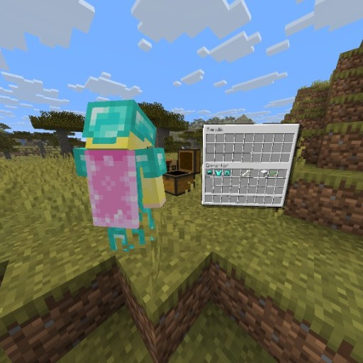
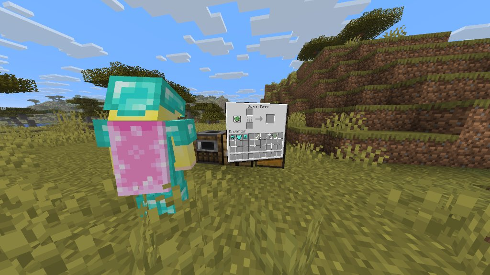
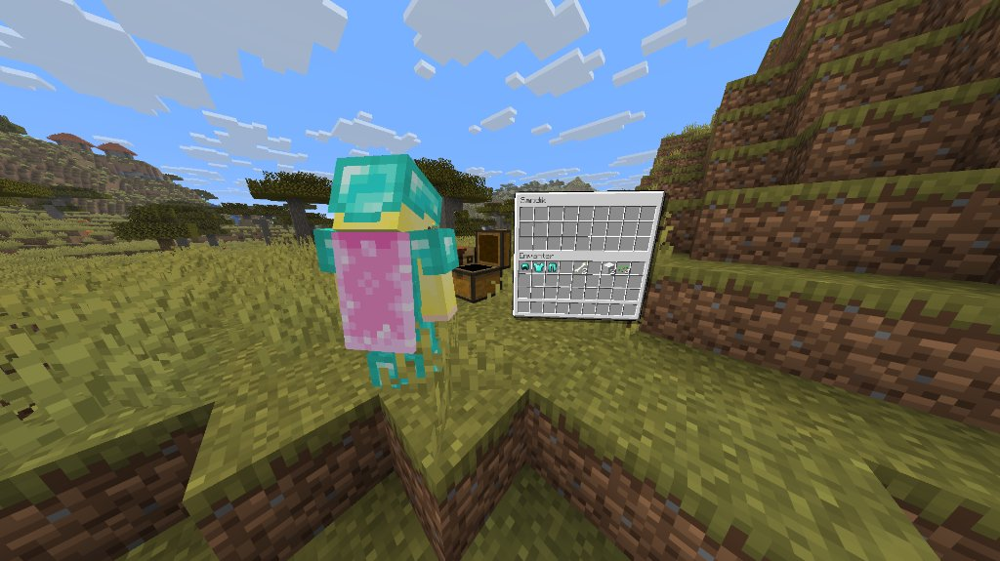
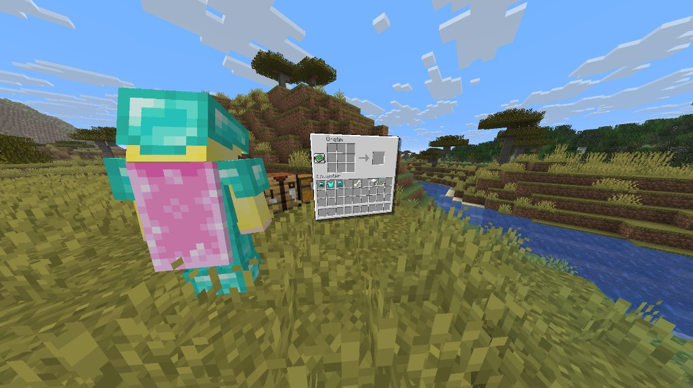
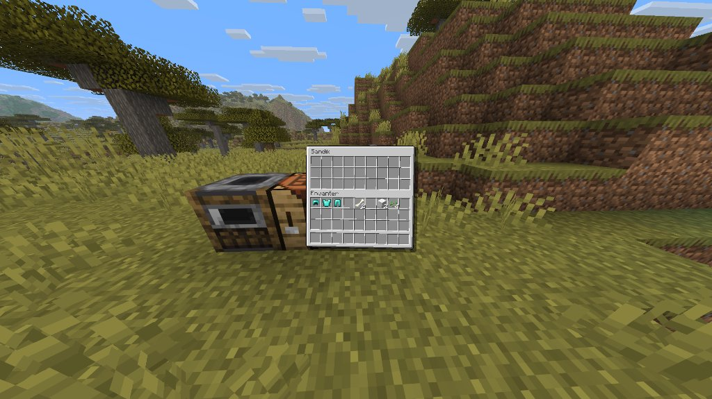
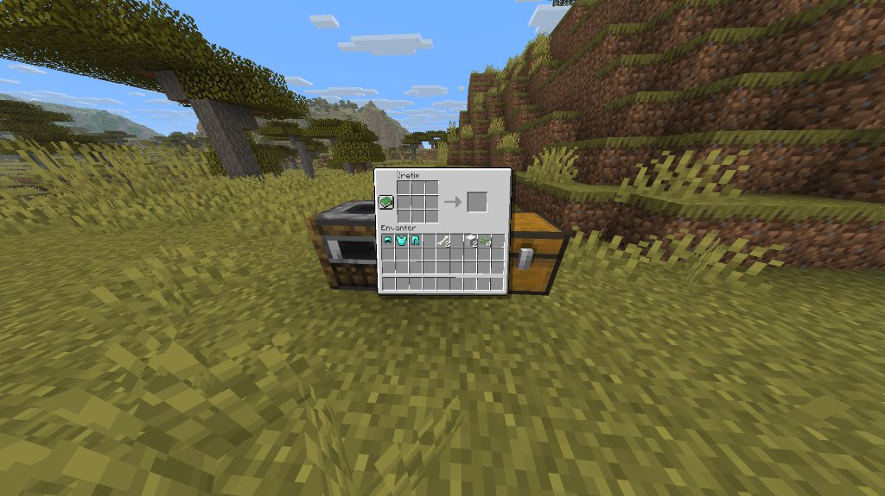
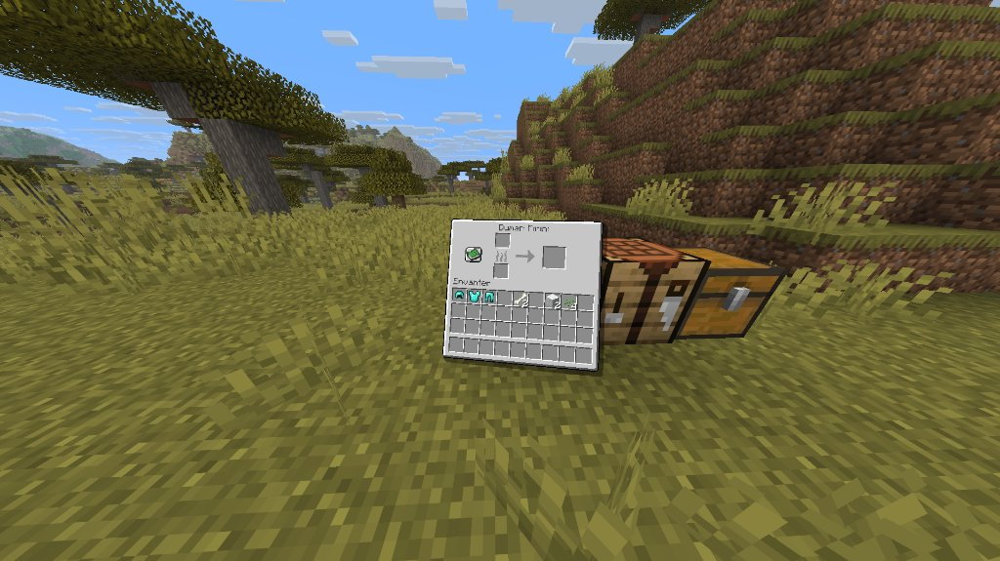

<p align="center">
  
</p>

<h1 align="center">Spatial GUI for Horizon</h1>

<p align="center">
  Renders inventory, creative, and container screens as an interactive 3D plane in the world with smooth third-person over-the-shoulder camera transitions.
</p>

<p align="center">
  <strong>Horizon Native Mod (Minecraft: Java Edition 26.3 — Rust)</strong> · MIT License
</p>

---

## Showcase

### Third-Person Over-the-Shoulder Mode
Your camera smoothly swings behind and beside your player model while the opened container or inventory floats in 3D world space with a subtle drop shadow.

| Smoker | Chest | Crafting Table |
| :---: | :---: | :---: |
|  |  |  |

### First-Person Mode
Keeps your normal first-person perspective and hand visible while projecting the opened UI directly in front of you in 3D space.

| Chest | Crafting Table | Smoker |
| :---: | :---: | :---: |
|  |  |  |

---

## Features

- **World-Space 3D GUI Plane:** Projects inventory, creative, and container screens (chests, furnaces, smokers, crafting tables, workstations) into 3D world space using Horizon's active camera `View × Projection` matrix.
- **Smooth Third-Person Camera Swing:** Automatically transitions (`easeOutCubic`) to an over-the-shoulder view showing your 3D player model beside the menu, and smoothly returns to your original camera mode when closed.
- **First-Person Mode:** Optional first-person 3D floating UI mode with dedicated distance, scale, and yaw angle sliders.
- **Analytic Ray-Plane Cursor Mapping:** Mouse coordinates are analytically unprojected onto the 3D plane every frame so slot clicks, drags, shift-clicks, and tooltips align accurately.
- **Clean World & 3D Drop Shadow:** Clears the dark screen tint and background blur while rendering a subtle 3D silhouette shadow behind the floating UI panel.
- **Adaptive Quad Subdivision:** Subdivides large UI panels to prevent affine texture warping under perspective projection, while keeping 3D item/player previews (`Blend::Depth`) and flat overlays (F3 debug screen, advancement/recipe toasts) untouched.
- **In-Game Configuration & Keybind:** Full English settings with descriptive tooltips in **Options → Mods → Spatial GUI → Config**, plus a toggle keybind (**`F8`** by default in **Options → Controls**).

> **Multiplayer Warning:** Spatial GUI is **disabled by default** (`Enable Spatial GUI = false`) because it remaps inventory cursor input onto the 3D world plane. Some multiplayer servers or anti-cheat plugins may disallow or flag modified inventory cursor input. Always check a server's rules before enabling this mod in multiplayer. In addition, the third-person camera position override is kept off in multiplayer (and block-collision clipped in singleplayer).

---

## Configuration (`Options → Mods → Spatial GUI → Config`)

| Setting | Default | Description |
| --- | --- | --- |
| **Enable Spatial GUI** | `false` | Master toggle for 3D world-space GUI rendering (press `F8` in-game or toggle in mod settings). |
| **Camera View Mode** | `Third Person` | Switch between `Third Person` (over-the-shoulder) and `First Person`. |
| **Mirror Third Person Side** | `false` | Flips the third-person camera and floating GUI to the opposite side. |
| **Clear World Backdrop & Blur** | `true` | Removes dark tint and background blur behind the 3D GUI. |
| **3D Drop Shadow** | `true` | Draws a subtle floating shadow behind the 3D panel. |
| **3P Camera Distance / Side / Height** | `1.7 / -1.2 / 1.5` | Controls third-person camera placement around your player. |
| **3P Screen Distance / Side / Height** | `2.5 / -0.6 / -0.4` | Controls floating GUI placement in third-person mode. |
| **3P Screen Angle (Yaw)** | `160°` | `180°` faces straight ahead; `<180°` angles right; `>180°` (e.g. `205°`) angles left toward your player. |
| **3P Screen Scale** | `3.5` | World-space scale of the floating GUI in third-person mode. |
| **1P Screen Distance / Scale / Angle** | `1.35 / 2.35 / 172°` | Controls distance, scale, and yaw angle in first-person mode. |
| **Camera Transition (ms)** | `300` | Duration of camera swing and open/close animations. |
| **Subdivide Large Quads** | `true` | Subdivides large panels to prevent perspective UV warping. |

---

## Transparency & Security

This mod uses `#![deny(unsafe_code)]`, makes **zero network requests**, collects **no telemetry**, and performs **no unauthorized file access**.

- **`mod_api::Hooks`:** `camera_pose`, `menu_background`, `screen_transparent_background`, `screen_opening`, `screen_closing`, `setting_changed`, `client_tick_post`.
- **`[[native.mixin]]` targets:**
  1. `horizon_client::game::Game<'_>::hud` (`HEAD` — `src/mixins/hud_head.rs`)
  2. `horizon_client::game::titles::Game<'_>::draw_saving_indicator` (`HEAD` — `src/mixins/hud_transform.rs`)
  3. `horizon_client::game::inventory_input::Game<'_>::inventory_drag_move` (`HEAD` — `src/mixins/cursor_map.rs`)

---

## Installation

### From GitHub (Horizon Launcher)
```sh
horizon-launcher mods add-github https://github.com/liqttt/horizon-spatial-gui --trust-native-code
```
Or download `spatial_gui.hmod` from the [Releases](https://github.com/liqttt/horizon-spatial-gui/releases) page, place it into your instance's `horizon-native-mods/` folder, enable **Spatial GUI** in **Mods**, and click **Build / Play**.

### Building from Source
```sh
cargo test
cargo horizon-mod build
cargo horizon-mod check target/horizon-mod/spatial_gui.hmod
horizon-launcher native-build . --instance "My Instance" --trust-native-code
```

---

## Credits & License

- **Original Java Mod & Concept:** [tastytrash/Spatial-GUI](https://github.com/tastytrash/Spatial-GUI) by **tastytrash** (MIT License)
- **Horizon Rust Port:** **liqttt**
- **License:** [MIT License](LICENSE)
